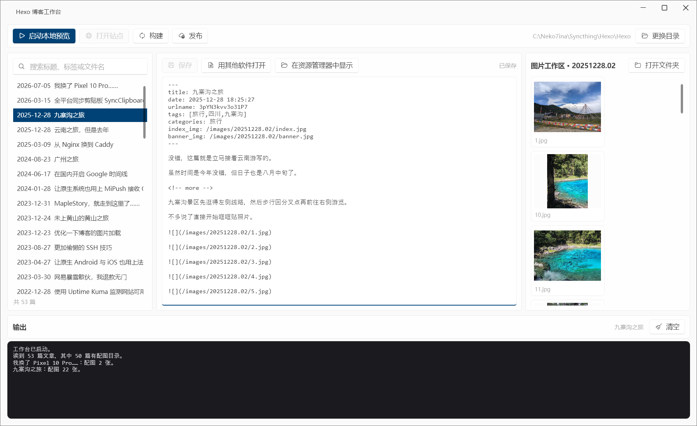

<p align="center"></p>

# HexoBlogStudio

一个给 Hexo 博客用的 Windows 工作台：不用开 git bash 就能起本地预览、写完直接发布，写文章时配图目录就在右边。



## 解决的几件事

- **起预览不用敲命令**：工具栏的按钮会根据状态变——没启动时是「启动本地预览」，启动后变成「停止本地预览」，不会让人以为服务已经开着。停止时连进程树一起结束，不留 node。
- **发布不用切终端**：点「发布」，写一句提交说明，程序同步远端、提交、按三条通道依次推送。推送失败会逐条试，日志里能看到走的是哪条。
- **配图不用退出 `_posts` 找**：选中文章，右边自动列出对应的 `source/images/<日期目录>` 缩略图。双击打开、右键「插入到正文」直接写进 markdown。
- **切文章不等图**：正文异步读、缩略图在后台并发解码（同时 3 张）。图多的文章也是点下去就切走，缩略图陆续补上；切换时上一批解码直接取消。
- **改文章不离开窗口**：内置编辑器改完 `Ctrl+S` 存盘；想看真效果就点「用其他软件打开」，改动会先落盘。

## 配图目录的对应规则

按顺序找，命中即停：

1. 文章文件名的日期前缀，`20251228.01-云南之旅.md` → `images/20251228.01/`
2. 正文里引用最多的 `/images/<目录>/`，防文件名和目录不同步
3. front-matter 里的 `date` 换算成 `yyyyMMdd`

都没有就算「没有配图目录」，列表照常显示。

## 发布的通道顺序

沿用原来手工脚本的结论，程序里按顺序试：

1. `github.com:22` 直连
2. `ssh.github.com:443` 经代理（`connect -H`，Git 自带）
3. `HTTPS` 加代理

推送前会先 `fetch` 比对远端：CI 会往 `main` 推主题同步提交，本地落后时直接推会被拒。落后就快进合并，本地有独立提交则停下来提示手动处理。

代理默认 `http://127.0.0.1:37777`，存在 `%APPDATA%\HexoBlogStudio\settings.json`。

## 自检

不启动界面的检查，出问题先跑这三条（参数依次是报告文件、站点目录）：

```powershell
dist\HexoBlogStudio.exe --selftest  "%TEMP%\selftest.txt" "C:\Neko7ina\Syncthing\Hexo\Hexo"
dist\HexoBlogStudio.exe --push-test "%TEMP%\push.txt"     "C:\Neko7ina\Syncthing\Hexo\Hexo"
dist\HexoBlogStudio.exe --serve-test "%TEMP%\serve.txt"   "C:\Neko7ina\Syncthing\Hexo\Hexo"
```

`--push-test` 用 `--dry-run`，只探测连通性，不改远端。`--sync-test` 会真的 fetch 并快进本地仓库。

## 构建

```powershell
.\build.ps1
```

产物 `dist\HexoBlogStudio.exe`（约 242 KB，框架依赖，需要 .NET 10 桌面运行时）。

## 已知边界

- 只认 Windows：用了 WPF 和资源管理器调用。
- 文章列表只扫 `source/_posts` 顶层，不含草稿与子目录。
- 新建文章仍需 `hexo new`：这一步还没做进界面。
